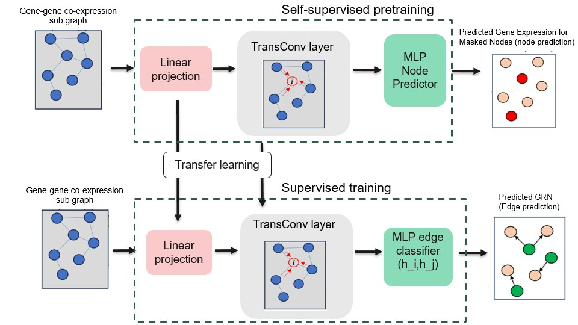

# GRNPred



GRNPred is a multimodal graph transformer framework for robust GRN inference that integrates gene expression, functional annotations, semantic gene descriptions, regulatory sequence priors, and network topology.
GRNPred follows a two-stage training strategy. In a self-supervised pretraining phase, a graph transformer encoder is trained on TF-centered subgraphs using masked gene-expression reconstruction, enabling the model to learn transcriptional context from unlabeled data. The pretrained encoder is then finetuned for supervised TF–target edge prediction using available regulatory annotations. Transformer-based attention allows GRNPred to capture long-range and context-dependent regulatory interactions that are difficult to model with conventional graph neural networks. 

---
## 📦 Download Required Supporting Files

```bash
# Motif score
wget https://github.com/tomnguyen4/GRNPred/releases/download/Data/v1.0.0/motif_score.tsv

# TF motif binding log-odds
wget https://github.com/tomnguyen4/GRNPred/releases/download/Data/v1.0.0/tf_binding_logodds.csv

# GO term definitions / names
wget https://github.com/tomnguyen4/GRNPred/releases/download/Data/v1.0.0/go_term.csv

# Text descriptions for genes
wget https://github.com/tomnguyen4/GRNPred/releases/download/Data/v1.0.0/text_description.csv

# Human transcription factor
wget https://github.com/tomnguyen4/GRNPred/releases/download/Data/v1.0.0/human-tfs.csv
```
Google Drive (backup): https://mailmissouri-my.sharepoint.com/:f:/g/personal/tmnthc_umsystem_edu/EiYQzBD_oypCuVZyJOSY95ABSmPkhgMTEAusQwCFzrDpjQ?e=7ztFia

---

## ⚙️ Ensuring Reproducibility

To obtain identical results, please also download the precomputed LLaMA text embedding cache and place it in your project directory:

```text
.cache_llama_embeds/
│
├── all-MiniLM-L6-v2_mESC_Non_specific_CHIP_tf500_ExpressionData.csv_embeds.npy
├── all-MiniLM-L6-v2_mHSC-GM_Celltype_CHIP_tf1000_ExpressionData.csv_embeds.npy
├── ...
```

Google Drive: https://mailmissouri-my.sharepoint.com/:f:/g/personal/tmnthc_umsystem_edu/EttkuWwfXvdOlv0KwyF6c1wB0E5QvugNg9aqJsReTJTIWQ?e=YZzH1s

---

## 🚀 How to Run

Run the main script and provide the 3 required input paths.  
The `main.py` will automatically load the data, split edges into 70/15/15 (train/val/test), train the model, and then run final evaluation on the full test split.

If you run out of memory, you can adjust dimension from 128 to 64. But please keep in mind, the result may not be as good.

For example: 
```bash
python main.py \
  --expr_path mHSC-GM_Non_specific_CHIP_tf1000_ExpressionData.csv \
  --label_path mHSC-GM_Non_specific_CHIP_tf1000_refNetwork.csv \
  --tf_path    human-tfs.csv
```
---

## 📑 Required Supporting Files

These must be present in the working directory (or provided via flags like `--priors_path`, `--tf_bind_path`, etc.):

- `gene_go_pairs.csv`
- `tf_binding_logodds.csv`
- `go_term.csv`
- `text_description.csv`

---

## 🔍 To Run Inference from Pretrained Weight

If you want to run inference **without training**, you can use a pretrained model checkpoint (`.pt`) together with a custom list of gene pairs.

### 📥 Required Inputs

- Pretrained model checkpoint (`pretrained_weight.pt`)
- Expression file (`--expr_path`)
- TF list (`--tf_path`)
- Test pairs file (`--test_pair_path`)  
- Supporting files (same as training):
  - `gene_go_pairs.csv`
  - `tf_binding_logodds.csv`
  - `go_term.csv`
  - `text_description.csv`

▶️ Run Inference

For example: 
```bash
python3 inference.py \
  --expr_path /home/tmnthc/miniconda3/GRN2/GRN/mHSC-GM_Non_specific_CHIP_tf500_ExpressionData.csv \
   --tf_path    /home/tmnthc/miniconda3/GRN2/GRN/human-tfs.csv
   --test_pair_path  /home/tmnthc/miniconda3/GRN2/GRN/GRNPred-main_2/Test_pair.csv

```
📤 Output

- A CSV file containing predictions for each input pair:
  -(Gene1, Gene2, prediction score)

---

### 🧪 Format of Test Pair File

The test pair CSV must contain:

```csv
Gene1,Gene2
GeneA,GeneB
GeneC,GeneD
GeneE,GeneF
...
```

